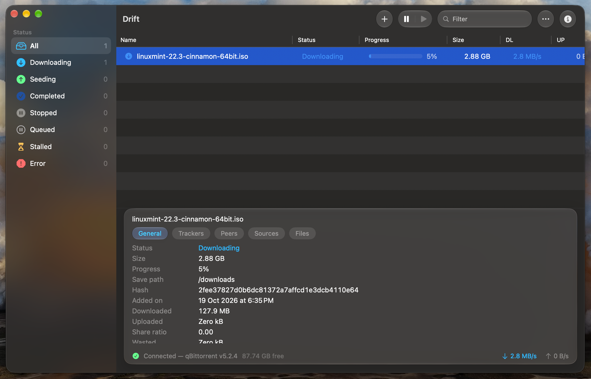
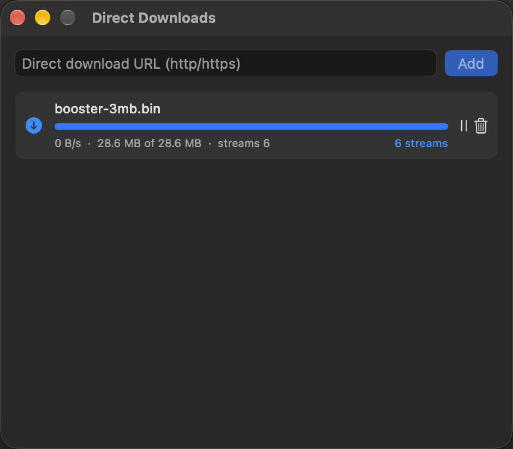

# Drift

<p align="center">
  <b>Drift</b> — a native macOS BitTorrent client with a built-in engine.<br>
  No server, no Docker, no separate qBittorrent install.
</p>


## Screenshots

| Torrent list + details | Feature cards in Settings | Connection Booster |
| --- | --- | --- |
|  |  |  |

*(More screenshots live in [`screenshots/`](screenshots).)*

## What is Drift?

Drift is a lightweight, native macOS BitTorrent client built with Swift 6,
SwiftUI and Apple's native frameworks. It ships its own out-of-process
**embedded libtorrent engine** (`drift-engine`) so the DMG works with zero
setup — no Docker and no separate qBittorrent install. The bundled engine is
the only backend; there is no server connection to configure.

**Status: beta (v2.2.0).** It is in active development; expect rough edges
and please report anything odd via [Issues](https://github.com/Harshsanket/drift/issues).

## Features

- **Embedded engine** — a bundled arm64 `drift-engine` built on libtorrent
  2.1.2, supervised as a child process over a private Unix socket. No Docker,
  server, or separate install.
- **Torrent list** — live status sidebar (All, Downloading, Seeding,
  Completed, Stopped, Queued, Stalled, Error) with counts, plus name,
  status, progress, size and per-torrent speeds; text filter box.
- **Details dock** — General, Trackers, Peers, Sources and Files tabs in a
  collapsible bottom dock, with the selected torrent's piece map in the
  status bar; per-file download priorities; add/edit/remove trackers and
  web seeds, reannounce; quick Boost, Remove, Delete Files and Finder
  actions.
- **Manage torrents** — start / stop / force start / recheck / queue to
  top, up, down, bottom; rename; remove (optionally delete files).
- Add via **magnet link, URL or .torrent file** (drag & drop; large file
  guard), with a configurable default save destination.
- **Categories and tags** to keep a large library tidy.
- **Import from qBittorrent** — point Drift at a `BT_backup` folder to bring
  torrents, progress, file priorities, category, tags and trackers into the
  embedded engine.
- **Speed control** — set global download/upload limits on the embedded
  engine from Settings.
- **WireGuard tunnel** — optional per-app HTTP tunnel powered by Partout
  through a privileged helper. It currently covers external search, booster
  downloads and update checks, not torrent peer traffic. The host keeps its
  normal routes and DNS. Paste a WireGuard `.conf` in Settings.
- **Peer Protection** — qBEE-style anti-leech: flags known leecher
  clients (Xunlei, Thunder, QQ, Baidu, Xfplay, DLBT, offline downloaders…),
  media players parked in the swarm, peers that connect but never move
  data (configurable timeout), and unknown clients from flagged regions.
  Runs in three modes — Off, Shadow (log only) and Auto-ban — with a
  client/IP whitelist and a log of recent decisions; bans are persisted by
  the embedded engine.
- **Connection Booster** — available for every incomplete torrent: Drift
  pauses the torrent, fetches missing pieces over parallel ranged HTTP,
  verifies each piece against the torrent's SHA-1, writes the files and
  resumes the torrent. A torrent's own HTTP web seeds are used automatically;
  without one, Drift asks for a direct HTTP(S) mirror of the files. Boost
  tasks and direct downloads live in the Downloads window.
- **Search** — queries **Jackett or Prowlarr** natively (base URL +
  Keychain API key) and feeds results straight into the built-in engine.
- **Statistics pane**, **dock badge** for active downloads, and
  **notifications when a download completes**.
- **Menu bar status item** with quick peek and controls, optional.
- **Power conscious** — optional "prevent idle sleep while transfers are
  active" toggle; the app is designed to stay out of the way when hidden.
- **Appearances** — System, Light and Dark themes.
- **Automatic update check** on launch: GitHub release metadata plus a
  Sparkle EdDSA appcast published as a release asset, with a manual
  "Check for Updates" button.

## How it works

- **DriftApp** sets up the scenes (main window, Settings window, Downloads
  window, menu bar item) and keeps one shared model.
- **ListViewModel** (`@MainActor`, observable) orchestrates the engine
  lifecycle, sidebar statistics, details caches and search state.
- **EmbeddedEngine** supervises `drift-engine` (C++17 + libtorrent 2.1.2)
  over a length-prefixed JSON protocol on a Unix socket, with resume
  persistence, heartbeats, crash restart and the `TorrentEngine` surface.
  The engine is arm64-only and statically linked.
- **LeechGuard** runs peer reviews against every detail refresh and applies
  ban decisions to the embedded engine; **Booster** (`DownloadCenter`) plans
  and races parallel ranged piece fetches for any incomplete torrent, from
  its web seeds or a user-supplied HTTP(S) mirror, with persisted progress
  for direct downloads.
- **TunnelService** drives `drift-tunnel-helper`, a root daemon that owns
  the utun and exposes a loopback-only HTTP relay; Partout handles WireGuard.
- The WireGuard profile and search API key are stored in the **macOS
  keychain**.
- `UpdateChecker` polls the repository's GitHub releases; Sparkle-backed
  `UpdateService` verifies EdDSA signatures when an appcast feed is
  configured.

## Third-party packages

Both dependencies are pinned exactly in `Package.swift` for reproducible
release builds and refreshed with `swift package update`.

- **[Partout](https://github.com/partout-io/partout)** (GPL-3.0) — the
  WireGuard tunnel core and the prebuilt `PartoutNative` framework used by
  the app and its privileged helper.
- **[Sparkle](https://github.com/sparkle-project/Sparkle)** (MIT) — EdDSA
  update verification and installation. The SwiftUI update surfaces drive
  the user decision; Sparkle performs the signed swap.

The embedded engine also uses **libtorrent 2.1.2** (BSD-3-Clause),
**Boost** (BSL-1.0) and **OpenSSL 3** (Apache-2.0); attribution ships in
`engine/licenses/` and inside the app bundle. The Drift app itself uses
Foundation, SwiftUI, AppKit, URLSession and the two packages above.

## Requirements

- macOS 26 (Tahoe) or later, Apple Silicon (ARM64)
- Nothing else — the engine is in the app.
- For the optional tunnel: a WireGuard profile and admin approval to start
  the privileged helper

## How to make it work

### 1. Grab a release build (embedded mode)

`Drift-2.2.0-arm64.dmg` — or the matching `Drift-2.2.0-arm64.zip` — from
the [Releases](https://github.com/Harshsanket/drift/releases) page. Open
the DMG and drag Drift to Applications (or unzip and move `Drift.app`).

This build is ad-hoc signed and not notarized. On first launch macOS may
block it: open **System Settings → Privacy & Security → Open Anyway**, or
run `xattr -dr com.apple.quarantine /Applications/Drift.app`. Only do this
for a DMG from Drift's official Releases page.

That is the whole setup for embedded mode. Downloads live in
`~/Downloads` or the destination you pick in the Add sheet.

### 2. Build from source

```sh
git clone https://github.com/Harshsanket/drift
cd drift
(cd engine && ./build.sh)           # static libtorrent engine (arm64)
swift build --arch arm64
./Scripts/package-dev-app.sh        # → .build/Drift.app
open .build/Drift.app
```

Release DMG + ZIP (ad-hoc, EULA/background, Sparkle appcast):

```sh
./Scripts/package-dmg.sh
# → dist/Drift-2.2.0-arm64.dmg
# → dist/Drift-2.2.0-arm64.zip
# → dist/appcast.xml + release notes + SHA-256 files
```

Run the unit suite with `swift test --arch arm64`.

> Building needs a recent Xcode with the macOS 26 SDK, CMake, and
> Homebrew `boost` + `openssl@3` (the engine links them statically).

## Languages used

- **Swift** (SwiftUI, AppKit, Swift Concurrency) — the entire app
- **C++17 + libtorrent 2.1.2** — the embedded engine (`engine/`)
- **Swift Package Manager / CMake** — app + engine build systems
- **Bash** — dev/release packaging scripts

## Thanks

- **Thank you to libtorrent and qBittorrent's contributors** — Drift builds
  on libtorrent and borrows qBittorrent's user-facing conventions.
- Development was **helped along by GLM 5.3**.
- Proudly **made in Mumbai by Harsh Sanket**.

---

a **Harsh Sanket** production
