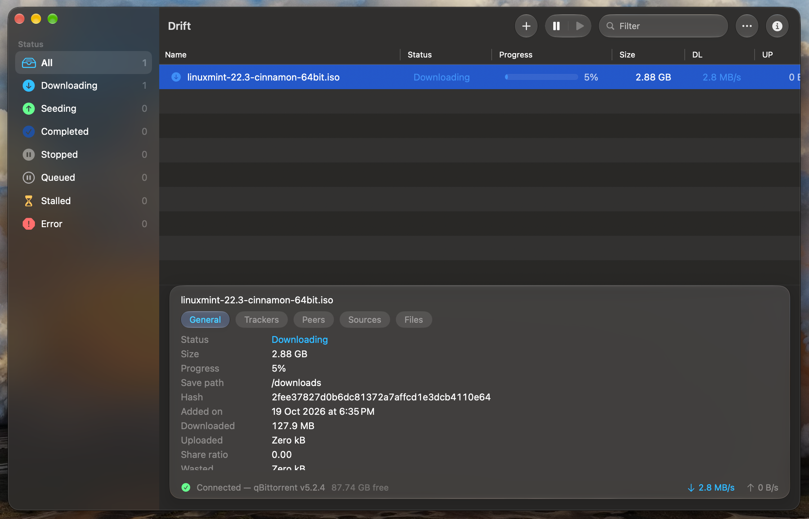
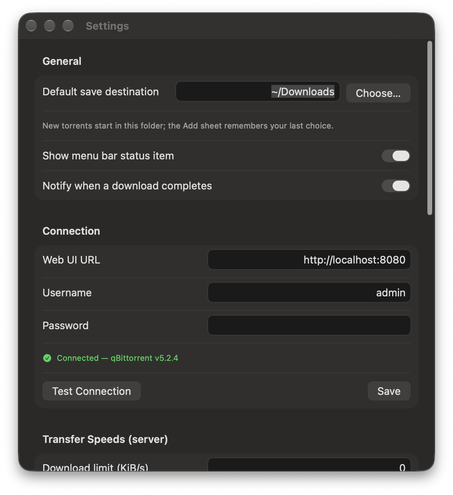

# Drift

<p align="center">
  <b>Drift</b> — a native macOS client for the qBittorrent Web API.<br>
  Your server keeps doing the work; Drift makes it feel like a Mac app.
</p>


## Screenshots

| Torrent list + details | Settings |
| --- | --- |
|  |  |

*(More screenshots live in [`screenshots/`](screenshots).)*

## What is Drift?

Drift is a lightweight, native macOS BitTorrent client built with Swift 6,
SwiftUI and Apple's native frameworks, powered by the [qBittorrent](https://www.qbittorrent.org)
Web API. The transfers themselves always run in qBittorrent — on your Mac,
a home server, or a seedbox — and Drift is the efficient native frontend
that talks to it.

**Status: beta (v1.0.0).** It is in active development; expect rough edges
and please report anything odd via [Issues](https://github.com/Harshsanket/drift/issues).

## Features

- **Torrent list** — live status sidebar (All, Downloading, Seeding,
  Completed, Stopped, Queued, Stalled, Error) with counts, plus name,
  status, progress, size and per-torrent speeds; text filter box.
- **Details panel** — General, Trackers, Peers, Sources and Files tabs;
  per-file download priorities; add/edit/remove trackers and web seeds,
  reannounce.
- **Manage torrents** — start / stop / force start / recheck / queue to
  top, up, down, bottom; rename; remove (optionally delete files).
- Add via **magnet link, URL or .torrent file** (drag & drop; large file
  guard), with a configurable default save destination.
- **Categories and tags** to keep a large library tidy.
- **Speed control** — set global and alternative speed limits straight on
  the server from Settings.
- **Search** — qBittorrent's plugin search from a native sheet: start,
  watch results stream in, stop or delete a run, download results.
- **RSS** — subscribe to RSS feeds from qBittorrent, read article lists,
  refresh, mark read, and grab items as downloads.
- **Statistics sheet**, **dock badge** for active downloads, and
  **notifications when a download completes**.
- **Menu bar status item** with quick peek and controls, optional.
- **Power conscious** — adaptive tiered sync (0.35–1.2 s) that speeds up
  while transfers are active and slows down when idle, keeps the app at
  ~0 % CPU when the window is hidden, and an optional "prevent idle sleep
  while transfers are active" toggle.
- **Appearances** — System, Light and Dark themes.
- **Automatic update check** (GitHub releases) on launch plus a manual
  "Check for Updates" button.

## How it works

- **DriftApp** sets up the scenes (main window, Settings window, menu bar
  item) and keeps one shared model.
- **ListViewModel** (`@MainActor`, observable) orchestrates everything:
  connection lifecycle, sync tiers, sidebar statistics, details caches,
  search and RSS state.
- **WebAPIEngine** is a dependency-free `URLSession` client for the
  qBittorrent Web API (API 2.x): session-cookie login, form-encoded
  actions, and a delta-based sync loop (`sync/maindata` + per-section
  sync) that adapts its polling interval to activity.
- The password is stored securely in the **macOS keychain**.
- `UpdateChecker` polls the repository's GitHub releases for new versions.

No third-party packages — the app only uses Foundation, SwiftUI, AppKit
and URLSession.

## Requirements

- macOS 26 (Tahoe) or later, Apple Silicon (ARM64)
- A qBittorrent instance with its **Web UI enabled**
  (tested against qBittorrent 5.2.x; API 2.17)

## How to make it work

### 1. Enable the qBittorrent Web UI

In qBittorrent: **Tools → Options → Web UI** → enable *"Web User
Interface (Remote control)"*, pick a port (e.g. 8080) and set a
username/password.

### 2. Connect Drift

Open Drift → **Settings** → enter the Web UI URL
(`http://<host>:<port>`), username and password → **Test Connection** →
**Save**. The password is kept in your keychain.

### 3. Or grab a release build

`Drift-1.0.0-arm64.dmg` from the
[Releases](https://github.com/Harshsanket/drift/releases) page, drag to
Applications, and launch (right-click → **Open** the first time so the
ad-hoc developer build is allowed).

### 4. Build from source

```sh
git clone https://github.com/Harshsanket/drift
cd drift
swift build --arch arm64
./Scripts/package-dev-app.sh        # → .build/Drift.app
open .build/Drift.app
```

Run the unit suite with `swift test --arch arm64`.

> Building needs a recent Xcode with the macOS 26 SDK and
> `xcode-select` pointing at it.

## Languages used

- **Swift** (SwiftUI, AppKit, Swift Concurrency) — the entire app
- **Swift Package Manager** — build system and tests
- **Bash** — dev packaging scripts

## Thanks

- **Thank you to the qBittorrent engine and its contributors** — Drift is
  the native face of their excellent work over the Web API.
- Development was **helped along by GLM 5.3**.
- Proudly **made in Mumbai by Harsh Sanket**.

---

a **Harsh Sanket** production
