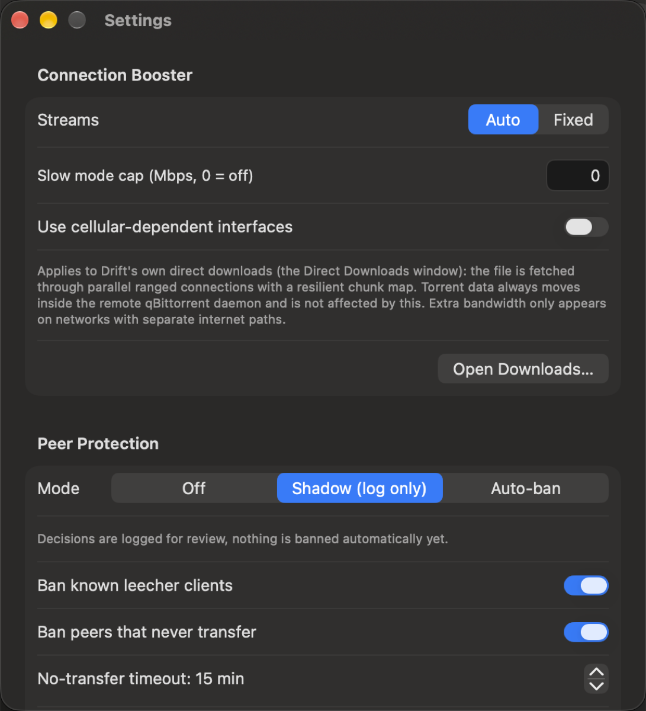

# Drift

<p align="center">
  <b>Drift</b> — a native macOS client for the qBittorrent Web API.<br>
  Your server keeps doing the work; Drift makes it feel like a Mac app.
</p>


## Screenshots

| Torrent list + details | Feature cards in Settings | Connection Booster |
| --- | --- | --- |
|  |  |  |

*(More screenshots live in [`screenshots/`](screenshots).)*

## What is Drift?

Drift is a lightweight, native macOS BitTorrent client built with Swift 6,
SwiftUI and Apple's native frameworks. It ships its own out-of-process
**embedded libtorrent engine** (`drift-engine`) so the DMG works with zero
setup — no Docker, no separate qBittorrent install. The original
[qBittorrent](https://www.qbittorrent.org) Web API mode is retained as an
opt-in for remote servers and seedboxes.

**Status: beta (v1.2.0).** It is in active development; expect rough edges
and please report anything odd via [Issues](https://github.com/Harshsanket/drift/issues).

## Features

- **Embedded engine (default)** — a bundled arm64 `drift-engine` built on
  libtorrent 2.1.2, supervised as a child process over a private Unix
  socket. Fresh installs need no server; the qBittorrent Web API mode stays
  available in **Settings → Torrent Engine**.
- **Torrent list** — live status sidebar (All, Downloading, Seeding,
  Completed, Stopped, Queued, Stalled, Error) with counts, plus name,
  status, progress, size and per-torrent speeds; text filter box.
- **Details dock** — General, Trackers, Peers, Sources and Files tabs in a
  collapsible bottom dock, with the selected torrent's piece map in the
  status bar; per-file download priorities; add/edit/remove trackers and
  web seeds, reannounce; quick Boost, Remove, Delete Files and Finder
  actions.
- **Manage torrents** — start / stop / force start / recheck / queue to
  top, up, down, bottom; rename; remove (optionally delete files).
- Add via **magnet link, URL or .torrent file** (drag & drop; large file
  guard), with a configurable default save destination.
- **Categories and tags** to keep a large library tidy.
- **Speed control** — set global and alternative speed limits straight on
  the server from Settings.
- **WireGuard tunnel** — optional per-app tunnel powered by Partout through
  a privileged helper: only Drift's own URL sessions use it, the host
  keeps its normal routes and DNS, and a kill switch blocks egress while
  the tunnel is down. Paste a WireGuard `.conf` in Settings.
- **Peer Protection** — qBEE-style anti-leech: flags known leecher
  clients (Xunlei, Thunder, QQ, Baidu, Xfplay, DLBT, offline downloaders…),
  media players parked in the swarm, peers that connect but never move
  data (configurable timeout), and unknown clients from flagged regions.
  Runs in three modes — Off, Shadow (log only) and Auto-ban — with a
  client/IP whitelist and a log of recent decisions; bans go straight to
  the server's `banned_IPs` list.
- **Connection Booster** — accelerates downloading torrents that expose
  HTTP web seeds: Drift pauses the torrent, fetches missing pieces over
  parallel ranged HTTP, verifies each piece against the torrent's SHA-1,
  writes the files and resumes qBittorrent. Boost tasks and legacy direct
  downloads live in the Downloads window.
- **Search** — server mode uses qBittorrent's plugin search (install,
  enable/disable, update or remove). Embedded mode queries **Jackett or
  Prowlarr** natively (base URL + Keychain API key) and feeds the result
  straight into the built-in engine.
- **RSS** — subscribe to RSS feeds from qBittorrent, read article lists,
  refresh, mark read, and grab items as downloads.
- **Statistics pane**, **dock badge** for active downloads, and
  **notifications when a download completes**.
- **Menu bar status item** with quick peek and controls, optional.
- **Power conscious** — adaptive tiered sync (0.35–1.2 s) that speeds up
  while transfers are active and slows down when idle, keeps the app at
  ~0 % CPU when the window is hidden, and an optional "prevent idle sleep
  while transfers are active" toggle.
- **Appearances** — System, Light and Dark themes.
- **Automatic update check** (GitHub releases) on launch plus a manual
  "Check for Updates" button.

## How it works

- **DriftApp** sets up the scenes (main window, Settings window, Downloads
  window, menu bar item) and keeps one shared model.
- **ListViewModel** (`@MainActor`, observable) orchestrates everything:
  connection lifecycle, sync tiers, sidebar statistics, details caches,
  search and RSS state.
- **EmbeddedEngine** supervises `drift-engine` (C++17 + libtorrent 2.1.2)
  over a length-prefixed JSON protocol on a Unix socket, with resume
  persistence, heartbeats, crash restart and the same `TorrentEngine`
  surface as server mode. The engine is arm64-only and statically linked.
- **WebAPIEngine** is a dependency-free `URLSession` client for the
  qBittorrent Web API (API 2.x): session-cookie login, form-encoded
  actions, and a delta-based sync loop (`sync/maindata` + per-section
  sync) that adapts its polling interval to activity.
- **LeechGuard** runs peer reviews against every detail refresh and
  routes ban decisions to the server; **Booster** (`DownloadCenter`) plans
  and races parallel ranged piece fetches for torrents with HTTP web
  seeds, with persisted progress for direct downloads.
- **TunnelService** drives `drift-tunnel-helper`, a root daemon that owns
  the utun and exposes a loopback-only relay; Partout handles WireGuard,
  and only Drift's URLs are proxied.
- The password and WireGuard profile are stored securely in the **macOS
  keychain**.
- `UpdateChecker` polls the repository's GitHub releases; Sparkle-backed
  `UpdateService` verifies EdDSA signatures when an appcast feed is
  configured.

## Third-party packages

Both dependencies are pinned exactly in `Package.swift` for reproducible
release builds and refreshed with `swift package update`.

- **[Partout](https://github.com/partout-io/partout)** (GPL-3.0) — the
  WireGuard tunnel core and the prebuilt `PartoutNative` framework used by
  the app and its privileged helper.
- **[Sparkle](https://github.com/sparkle-project/Sparkle)** (MIT) — EdDSA
  update verification and installation. The SwiftUI update surfaces drive
  the user decision; Sparkle performs the signed swap.

The embedded engine also uses **libtorrent 2.1.2** (BSD-3-Clause),
**Boost** (BSL-1.0) and **OpenSSL 3** (Apache-2.0); attribution ships in
`engine/licenses/` and inside the app bundle. The Drift app itself uses
Foundation, SwiftUI, AppKit, URLSession and the two packages above.

## Requirements

- macOS 26 (Tahoe) or later, Apple Silicon (ARM64)
- **Embedded mode (default):** nothing else — the engine is in the app.
- **Server mode (optional):** a qBittorrent instance with its **Web UI
  enabled**; search plugins are needed only for server-mode search
  (tested against qBittorrent 5.2.4; Web API v2.15.1 reported by the
  server — Drift also tolerates older/newer API leanings)
- For the optional tunnel: a WireGuard profile and admin approval to start
  the privileged helper

## How to make it work

### 1. Grab a release build (embedded mode)

`Drift-1.2.0-arm64.dmg` from the
[Releases](https://github.com/Harshsanket/drift/releases) page. Drag Drift
to Applications and launch.

This build is ad-hoc signed and not notarized. On first launch macOS may
block it: open **System Settings → Privacy & Security → Open Anyway**, or
run `xattr -dr com.apple.quarantine /Applications/Drift.app`. Only do this
for a DMG from Drift's official Releases page.

That is the whole setup for embedded mode. Downloads live in
`~/Downloads` or the destination you pick in the Add sheet.

### 2. Optional: use a qBittorrent server

Open **Settings → Torrent Engine → qBittorrent server**, then enter the
Web UI URL (`http://<host>:<port>`), username and password → **Test
Connection** → **Save**. The password is kept in your keychain. In
qBittorrent enable **Tools → Options → Web UI**.

### 3. Build from source

```sh
git clone https://github.com/Harshsanket/drift
cd drift
(cd engine && ./build.sh)           # static libtorrent engine (arm64)
swift build --arch arm64
./Scripts/package-dev-app.sh        # → .build/Drift.app
open .build/Drift.app
```

Release DMG (ad-hoc, EULA/background, Sparkle appcast):

```sh
./Scripts/package-dmg.sh            # → dist/Drift-1.2.0-arm64.dmg
```

Run the unit suite with `swift test --arch arm64`.

> Building needs a recent Xcode with the macOS 26 SDK, CMake, and
> Homebrew `boost` + `openssl@3` (the engine links them statically).

## Languages used

- **Swift** (SwiftUI, AppKit, Swift Concurrency) — the entire app
- **C++17 + libtorrent 2.1.2** — the embedded engine (`engine/`)
- **Swift Package Manager / CMake** — app + engine build systems
- **Bash** — dev/release packaging scripts

## Thanks

- **Thank you to the qBittorrent engine and its contributors** — Drift is
  the native face of their excellent work over the Web API.
- Development was **helped along by GLM 5.3**.
- Proudly **made in Mumbai by Harsh Sanket**.

---

a **Harsh Sanket** production
